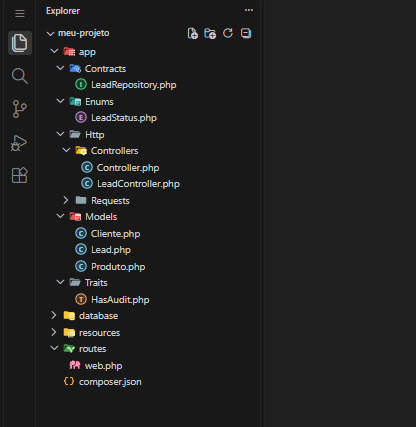
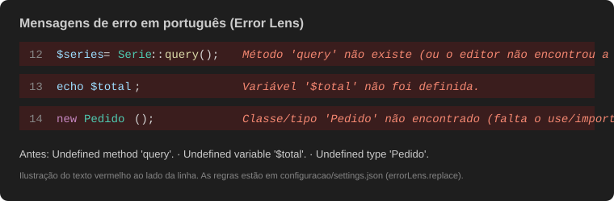

# PHP Tipos

Extensão do VS Code para quem trabalha com PHP e Laravel: **ícones em anel** para classe, interface, trait e enum, e **criação de arquivos** PHP, Laravel (CRUD completo) e Blade pelo botão direito do explorador.



## Instalar

No VS Code, abra a aba **Extensões**, busque por **PHP Tipos** e clique em **Instalar**. Ou rode:

```bash
code --install-extension cleversonnobrega.php-tipos
```

Também está na [página do Marketplace](https://marketplace.visualstudio.com/items?itemName=cleversonnobrega.php-tipos).

## Sobre a extensão

A descrição completa, com funcionalidades, passo a passo, configurações e imagens, está em **[extensao/README.md](extensao/README.md)** (é o mesmo texto da página no Marketplace).

## O que há neste repositório

| Pasta | Conteúdo |
|---|---|
| `extensao/` | A extensão: código, `package.json`, README, CHANGELOG, ícone e imagens |
| `configuracao/` | `settings.json`, lista de extensões (`extensoes.txt`) e `instalar.ps1` para montar outro computador |
| `scripts/empacotar.py` | Gera o instalador `.vsix` sem baixar nada da internet |

### Mapa do código (`extensao/`)

- `gera.js`: textos gerados (Model, Migration, Request, Controller, Blade). Não depende do VS Code, então é testável.
- `laravel.js` e `blade.js`: comandos e perguntas de Laravel e Blade.
- `novo.js`: Arquivo PHP, Classe, Interface, Trait, Enum e leitura de namespace (PSR-4).
- `gerar.js`: monta o tema de ícones lendo o Material Icon Theme.
- `extension.js`: ativação, observação de arquivos e configurações.

## Manutenção

**Testes** (simulam o VS Code num projeto temporário e conferem os arquivos com `php -l`; precisam de Node e PHP no PATH):

```bash
node extensao/testes/unidade.js
```

```bash
node extensao/testes/teste.js
```

**Gerar o instalador local** (`dist/php-tipos-<versão>.vsix`; precisa de Node, Python e do Material Icon Theme instalado):

```bash
python scripts/empacotar.py
```

**Instalar o instalador local:**

```bash
code --install-extension dist/php-tipos-1.0.0.vsix --force
```

Ao mudar o código, suba `version` em `extensao/package.json` e registre a mudança em `extensao/CHANGELOG.md`.

### Publicar no Marketplace

Exige uma conta, um *publisher* e um token (PAT) com permissão **Marketplace → Manage**. O token é seu: digite-o só no terminal, quando o `vsce` pedir, e nunca o salve no repositório.

Os links de imagem do README são relativos (`docs/...`); para o Marketplace eles precisam virar links `https`, e o repositório precisa ser **público**:

```bash
cd extensao
npx @vscode/vsce package --baseImagesUrl https://raw.githubusercontent.com/cleversonNobrega/vscode-php-tipos/main/extensao/
```

```bash
npx @vscode/vsce publish --baseImagesUrl https://raw.githubusercontent.com/cleversonNobrega/vscode-php-tipos/main/extensao/
```

Antes, gere o `tema.json` (o `vsce` não o cria): `node extensao/gerar.js`.

## Outro computador

1. Instale VS Code, PHP, Composer e Node.
2. Rode `configuracao/instalar.ps1`, que instala as extensões e o `.vsix` e copia o `settings.json` (com backup do atual).
3. Para formatar PHP ao salvar: `composer global require laravel/pint`.

## Mensagens de erro em português

As regras para o **Error Lens** mostrar o texto vermelho em português estão em `errorLens.replace` no `configuracao/settings.json`. Elas não fazem parte da extensão.



*Ilustração do texto vermelho ao lado da linha; só muda esse texto, o painel Problemas continua em inglês.*

## Licença

[MIT](extensao/LICENSE)
