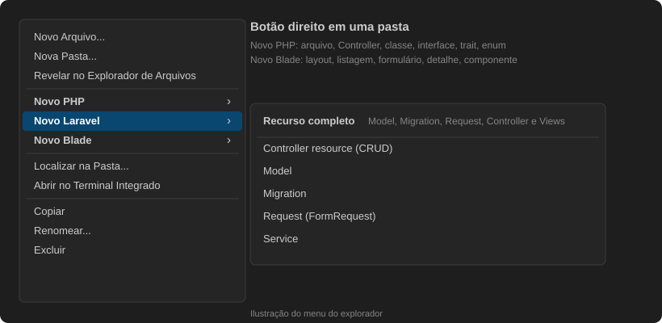

# PHP Tipos

Extensão do VS Code para quem trabalha com PHP e Laravel. Funciona em qualquer projeto: dá ícones diferentes para classe, interface, trait e enum, e cria arquivos pelo botão direito do explorador, já com namespace e código base.

Este repositório guarda a extensão (`extensao/`), a configuração do editor usada com ela (`configuracao/`) e o script que gera o instalador (`scripts/`).

## O que ela faz

### Ícones por tipo

O tema **"Material + PHP Tipos (anel)"** usa o Material Icon Theme e acrescenta um ícone em anel conforme o que o arquivo `.php` declara:

| Ícone | Tipo |
|---|---|
| **C** (azul) | classe |
| **I** (verde) | interface |
| **T** (laranja) | trait |
| **E** (roxo) | enum |

Arquivos sem declaração (rotas, configurações) ficam com o ícone padrão do PHP. O tema é refeito sozinho quando você cria, apaga ou salva arquivos `.php`.


### Criar arquivos pelo botão direito

Clique com o botão direito em uma **pasta** do explorador:

- **Novo PHP:** Arquivo PHP, Controller, Classe, Interface, Trait e Enum. O namespace sai do `composer.json` mais próximo (PSR-4).
- **Novo Laravel:**
  - **Recurso completo:** cria Model, Migration, Request, Controller e Views de uma vez e copia a linha de rota.
  - Controller resource (CRUD), Model, Migration, Request e Service avulsos.
- **Novo Blade:** layout base, listagem, formulário (criar e editar), detalhe, componente e view em branco ou com `@extends`.



Cada item só aparece na pasta que combina (Controller em `Controllers`, Model em `Models`, Migration em `migrations`, Request em `Requests`, Service em `Services`, Blade em `views`). Para ver tudo em qualquer pasta, ligue `phpTipos.mostrarTudo`.

### Recurso completo

O item **Novo Laravel → Recurso completo** faz três perguntas (nome do Model, campos e tipo do controller) e cria todos os arquivos de uma vez (Model, Migration, Request, Controller e, no modo Web, as views `index`, `_form`, `create`, `edit` e `show`).

**1. Os campos** (o nome do Model vem na pergunta anterior):


**2. O tipo do controller:**


**3. O controller gerado** (namespace, `use` e regras vêm do `composer.json` do projeto; a linha `Route::resource(...)` é copiada para a área de transferência):


> As capturas dos ícones e do Recurso completo são reais (VS Code com a extensão instalada, num projeto de exemplo). A imagem do menu do botão direito é uma ilustração.

### Campos

Model, Migration, Request, Controller resource e as telas Blade perguntam os campos (opcional):

```
name:string, email:string:unique, valor:decimal:nullable, ativo:boolean, company_id:foreignId
```

- **Tipos:** `string`, `text`, `integer`, `bigInteger`, `boolean`, `decimal`, `float`, `date`, `dateTime`, `json`, `foreignId`.
- **Modificadores:** `nullable` e `unique`.
- **O que gera:** colunas da migration, `$fillable` e `casts()`, regras de validação (com `Rule::unique()->ignore(...)` na edição e `exists:` nas chaves estrangeiras) e as colunas e inputs das telas.

## Instalação

Veja a pasta de instaladores ou gere o seu:

```bash
python scripts/empacotar.py
code --install-extension dist/php-tipos-icones-0.2.1.vsix --force
```

Depois escolha o tema em **Ctrl+Shift+P → Preferências: Tema de Ícones de Arquivo → Material + PHP Tipos (anel)** e recarregue a janela. O Material Icon Theme é instalado junto, como dependência.

## Configurações

| Configuração | Padrão | Para que serve |
|---|---|---|
| `phpTipos.plural` | `pt-BR` | Regra de plural de tabela, rota e variável. `pt-BR`: contato → contatos, item → itens, ação → ações. `en`: lead → leads, category → categories. |
| `phpTipos.pluraisPersonalizados` | `{}` | Exceções por Model. Ex.: `{ "Pessoa": "pessoas" }`. |
| `phpTipos.strictTypes` | `true` | Gera `declare(strict_types=1);` nos arquivos novos. |
| `phpTipos.layoutPadrao` | `layouts.app` | Layout usado nas telas quando o projeto não tem `resources/views/layouts`. Se tiver, usa o que existe (`app`, ou o primeiro arquivo). |
| `phpTipos.mostrarTudo` | `false` | Mostra todos os itens de menu em qualquer pasta. |
| `phpTipos.atualizarIconesSozinho` | `true` | Troca o tema por um instante para o VS Code reler os ícones sem recarregar a janela. |

## Estrutura do repositório

| Pasta | Conteúdo |
|---|---|
| `extensao/` | Código da extensão |
| `configuracao/` | `settings.json`, lista de extensões (`extensoes.txt`) e `instalar.ps1` |
| `scripts/empacotar.py` | Gera o `.vsix` sem baixar nada da internet |

### Mapa do código

- `gera.js`: textos gerados (Model, Migration, Request, Controller, Blade). Não depende do VS Code, então é testável.
- `laravel.js` e `blade.js`: comandos e perguntas.
- `novo.js`: Arquivo PHP, Controller, Classe, Interface, Trait, Enum e leitura de namespace.
- `gerar.js`: monta o tema de ícones.
- `extension.js`: ativação, observação de arquivos e configurações.

## Manutenção

Testes (simulam o VS Code num projeto temporário e conferem os arquivos com `php -l`; precisa de PHP no PATH):

```bash
node extensao/testes/teste.js
```

Ao mudar o código, suba `version` em `extensao/package.json` antes de empacotar.

## Outro computador

1. Instale VS Code, PHP, Composer e Node.
2. Rode `configuracao/instalar.ps1`, que instala as extensões e o `.vsix` e copia o `settings.json` (com backup do atual).
3. Para formatar PHP ao salvar: `composer global require laravel/pint`.

## Limites

- O ícone é escolhido pelo **nome** do arquivo: dois arquivos com o mesmo nome e tipos diferentes dividem o mesmo ícone.
- As telas Blade usam HTML simples, sem Bootstrap nem Tailwind.
- O plural em português segue regras simples e não coloca acentos (papel → papeis). Use `phpTipos.pluraisPersonalizados` nas exceções.
- O código gerado é um ponto de partida: não inclui autorização nem filtros próprios do seu projeto.
