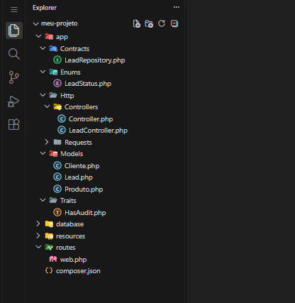
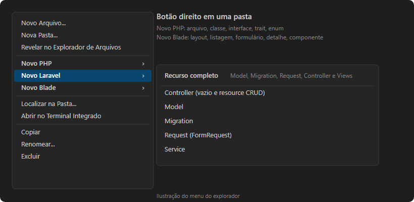
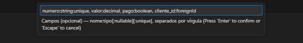
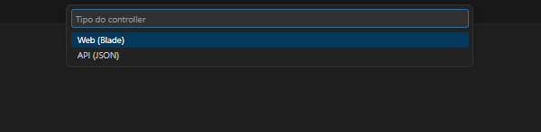
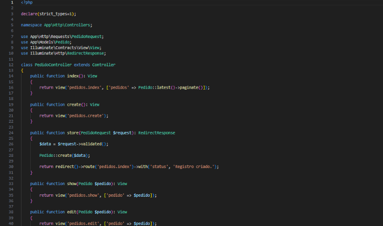

# PHP Tipos

**Ícones em anel para classe, interface, trait e enum — e criação rápida de arquivos PHP, Laravel e Blade pelo botão direito do explorador.**

Clique com o botão direito em uma pasta, escolha o que quer criar e informe o nome. A extensão cria o arquivo no lugar certo, com namespace, `use` e código base. No Laravel, ela cria Model, Migration, Request, Controller e telas já com a estrutura base. Se quiser, ative `phpTipos.perguntarCampos` para informar os campos (`name:string, email:string:unique`) e gerar também colunas, regras e inputs.



## Problemas que resolve

- **Todo arquivo `.php` tem o mesmo ícone.** Você não distingue uma classe de uma interface, de um trait ou de um enum sem abrir o arquivo.
- **Criar arquivo PHP é repetitivo.** Namespace, `declare(strict_types=1)`, `use`, chaves e nome da classe: a extensão escreve tudo isso.
- **Um CRUD no Laravel são muitos arquivos.** Model, Migration, Request, Controller e cinco telas, todos com os mesmos nomes e campos. Aqui é uma pergunta de nome (e, se você quiser, uma de campos).
- **Views Blade começam sempre iguais.** Layout, listagem, formulário e detalhe saem prontos, já com `@csrf`, `old()`, `@error` e paginação.

## Funcionalidades

### Ícones por tipo

O tema **"Material + PHP Tipos (anel)"** usa o Material Icon Theme e acrescenta um ícone em anel conforme o que o arquivo `.php` declara:

| Ícone | Tipo |
|---|---|
| **C** (azul) | classe |
| **I** (verde) | interface |
| **T** (laranja) | trait |
| **E** (roxo) | enum |

Arquivos sem declaração (rotas, configurações) ficam com o ícone padrão do PHP. O tema é refeito quando você cria, apaga ou salva arquivos `.php`.

### Botão direito em uma pasta

Três submenus, cada um com seus itens:



**Novo PHP**
- Arquivo PHP, Classe, Interface, Trait e Enum.
- O namespace sai do `composer.json` mais próximo (PSR-4), e o nome do arquivo vira `StudlyCase` (`lead_form` → `LeadForm`).

**Novo Laravel**
- **Recurso completo:** cria Model, Migration, Request, Controller e, no modo Web, as views `index`, `_form`, `create`, `edit` e `show`. Copia a linha `Route::resource(...)` para a área de transferência.
- Controller (vazio), Controller resource (CRUD), Model, Migration, Request e Service avulsos.
- O Controller resource escolhe sozinho entre **API (JSON)** e **Web (Blade)**: dentro de uma pasta `Api`, devolve JSON; nas demais, usa views.

**Novo Blade**
- Layout base, listagem (`index` com tabela), formulário (criar e editar), detalhe (`show`), componente (`x-nome`), view com `@extends` e view em branco.
- Usa o layout que o projeto já tem em `resources/views/layouts`.

Por padrão todos os itens aparecem em qualquer pasta. Se preferir que cada item só apareça na pasta que combina (Controller em `Controllers`, Model em `Models`, Migration em `migrations`, Request em `Requests`, Service em `Services`, Blade em `views`), desligue `phpTipos.mostrarTudo`.

### Campos (opcional)

Por padrão, os itens do Laravel e do Blade criam só a **estrutura base**, como o Novo PHP: um `//` marca onde ficariam as colunas, as regras de validação e os campos das telas.

Se você ligar `phpTipos.perguntarCampos`, Model, Migration, Request, Controller resource, Recurso completo e as telas Blade passam a perguntar os campos e a gerar o código a partir deles:

```
name:string, email:string:unique, valor:decimal:nullable, ativo:boolean, company_id:foreignId
```

- **Tipos:** `string`, `text`, `integer`, `bigInteger`, `boolean`, `decimal`, `float`, `date`, `dateTime`, `json`, `foreignId`.
- **Modificadores:** `nullable` e `unique`.
- **O que gera:** colunas da migration, `$fillable` e `casts()`, regras de validação (`Rule::unique()->ignore(...)` na edição e `exists:` nas chaves estrangeiras) e as colunas e inputs das telas.

## Como usar

### Criar uma classe, interface, trait ou enum

1. No explorador, clique com o botão direito na pasta onde o arquivo deve ficar.
2. Escolha **Novo PHP** e o tipo.
3. Digite o nome e tecle Enter. O arquivo abre já com o namespace certo.

### Criar um CRUD completo no Laravel

1. Clique com o botão direito em qualquer pasta do projeto e escolha **Novo Laravel → Recurso completo**.
2. Digite o nome do Model no singular (`Lead`).
3. Só se `phpTipos.perguntarCampos` estiver ligada: digite os campos, ou deixe em branco.



4. Escolha **Web (Blade)** ou **API (JSON)**.



5. A extensão cria os arquivos nas pastas do projeto e abre o controller. Cole a linha de rota (já copiada) em `routes/web.php` ou `routes/api.php`.



A extensão **nunca sobrescreve**: se algum dos arquivos já existir, ela avisa e não cria nenhum.

### Criar uma tela Blade

1. Clique com o botão direito em uma pasta dentro de `resources/views`.
2. Escolha **Novo Blade** e o modelo (listagem, formulário, detalhe...).
3. Informe o nome do Model (e os campos, se `phpTipos.perguntarCampos` estiver ligada).

## Configurações

| Configuração | Padrão | Para que serve |
|---|---|---|
| `phpTipos.mostrarPhp` | `true` | Mostra o submenu **Novo PHP** |
| `phpTipos.mostrarLaravel` | `true` | Mostra o submenu **Novo Laravel** |
| `phpTipos.mostrarBlade` | `true` | Mostra o submenu **Novo Blade** |
| `phpTipos.mostrarTudo` | `true` | Mostra todos os itens em qualquer pasta. Desligue para filtrar pelo nome da pasta |
| `phpTipos.perguntarCampos` | `false` | Pergunta os campos (`nome:tipo:nullable:unique`) e gera colunas, regras e inputs. Desligado, cria só a estrutura base |
| `phpTipos.plural` | `pt-BR` | Plural de tabela, rota e variável: `pt-BR` (contato → contatos, item → itens, ação → ações) ou `en` |
| `phpTipos.pluraisPersonalizados` | `{}` | Exceções por Model, por exemplo `{ "Pessoa": "pessoas" }` |
| `phpTipos.strictTypes` | `true` | Gera `declare(strict_types=1);` nos arquivos novos |
| `phpTipos.layoutPadrao` | `layouts.app` | Layout usado nas telas quando o projeto não tem `resources/views/layouts` |
| `phpTipos.atualizarIconesSozinho` | `true` | Troca o tema por um instante para o VS Code reler os ícones sem recarregar a janela |

## Diferenciais

- **Tudo em uma extensão:** ícones, PHP, Laravel e Blade, sem instalar vários pacotes.
- **Em português:** perguntas, mensagens e plural das tabelas e rotas.
- **Lê o seu projeto:** namespace pelo `composer.json`, layout Blade que já existe, pasta do Model e `Api/V1` quando houver.
- **Começa pelos campos:** a mesma lista de campos vira migration, regras de validação e telas.
- **Seguro:** nunca sobrescreve arquivos e não envia nada para a internet.
- **Leve:** sem dependências além do Material Icon Theme.

## Requisitos

- VS Code 1.80 ou mais novo.
- **Material Icon Theme** (instalado junto, como dependência).
- Para os namespaces e o Recurso completo, um `composer.json` com `autoload.psr-4` na raiz do projeto.

## Dica: mensagens de erro em português

Esta extensão não traduz as mensagens do editor, mas o repositório traz regras prontas para o **Error Lens** mostrar em português o texto vermelho ao lado da linha. Veja a pasta `configuracao/` no [repositório](https://github.com/cleversonNobrega/vscode-php-tipos).

## Limites

- O ícone é escolhido pelo **nome** do arquivo: dois arquivos com o mesmo nome e tipos diferentes dividem o mesmo ícone.
- As telas Blade usam HTML simples, sem Bootstrap nem Tailwind.
- O plural em português segue regras simples e não coloca acentos. Use `phpTipos.pluraisPersonalizados` nas exceções.
- O código gerado é um ponto de partida: não inclui autorização nem filtros próprios do seu projeto.

## Problemas e sugestões

Abra uma [issue no GitHub](https://github.com/cleversonNobrega/vscode-php-tipos/issues).

## Licença

[MIT](https://github.com/cleversonNobrega/vscode-php-tipos/blob/main/extensao/LICENSE)
